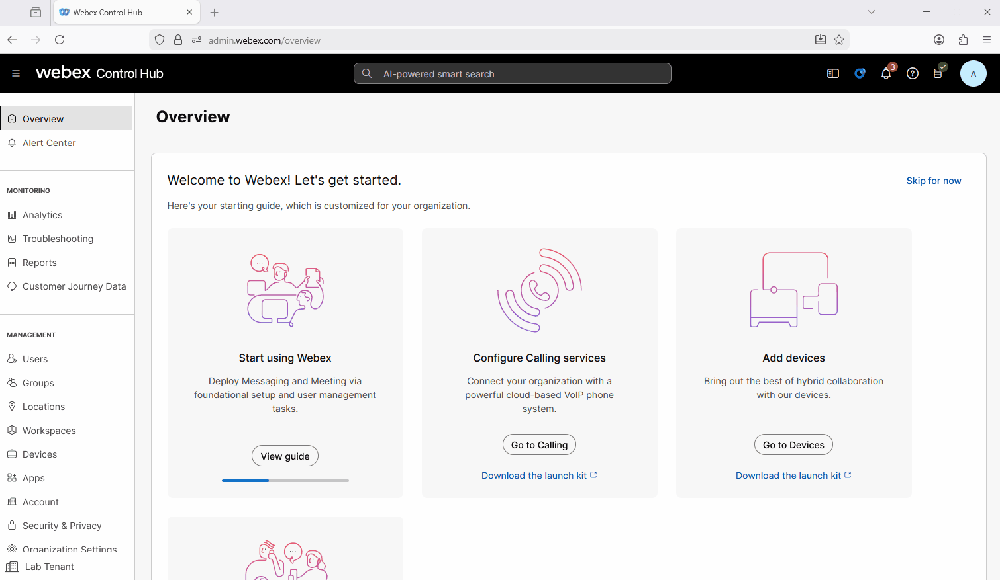
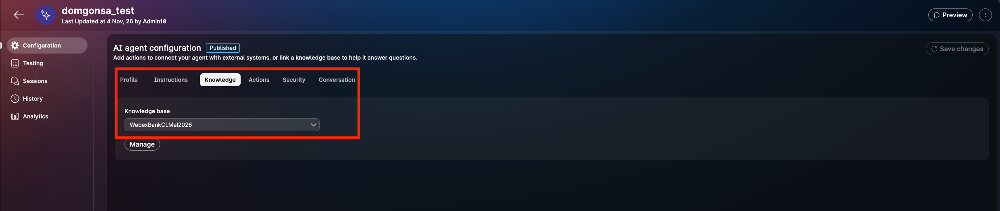
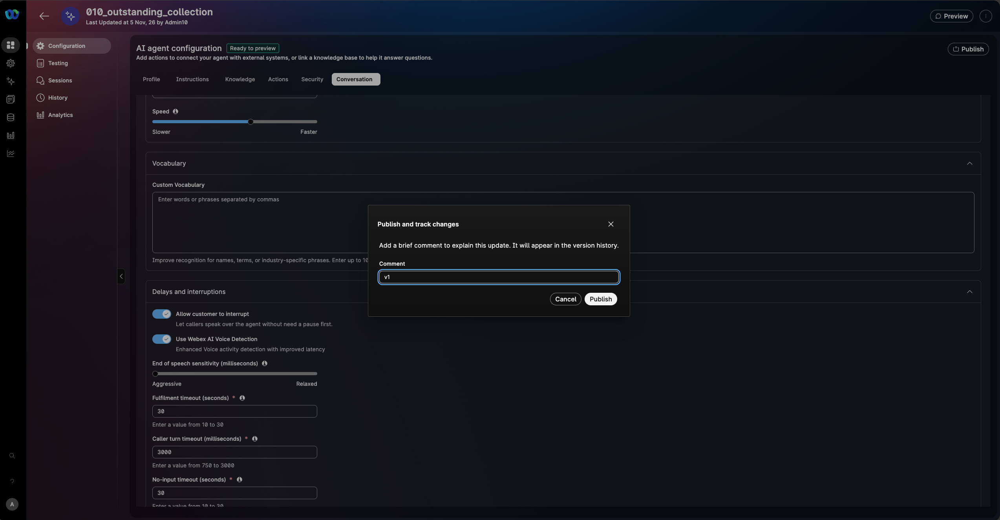

# Mission 1: Create AI Autonomous Agent

## Mission overview

Your mission is to:

**Create an AI agent** to enable the agent to transact and assist customers with making payments, enquiries on their accoubt or transferring the interaction to a human agent.
.jpg>)

---

## Build

## Pre-requisites

In order to be able to complete this lab, you need this:

[IMPORTANT]

You already have read access to our [Airtable repositories](https://airtable.com/appyHCipREdqlqiDe/shrQkcmfHDvxvFyHp) completed for the Customer data  

Not Required - Just in case:If needed, use the Airtable Credentials provided to you. 

You already have outgoing email configs/integrations setup in the tenant (Webex Connect).

### Task 1. Create Alex, your Banking AI Agent

1. In this first step, you will define the "brain" and personality of your AI Agent. You will configure the core identity of Alex, setting the professional and secure tone required for financial interactions. This section covers the implementation of the System Prompt, where you will establish the strict sequential logic—from name verification to debt disclosure—ensuring the agent acts as a secure first-line filter for Webex Financial Group.

2. [IMPORTANT] Download the file [Pre_config_AIAgent](../graphics/Lab1_AI_Agent/template_ai_agent_collection.json){: download="template_ai_agent_collection.json"}. The file might download to your browser’s configured download location. Move it to another folder if needed. If prompted, save it your computer's desktop or whereever you like it to be saved. We will need to use this in a bit.

    > **template_ai_agent_collection.json** - contains a prebuilt agent that we can import and step through, including the actions and what they mean.

3. Navigate to [Control Hub](https://admin.webex.com){:target="\_blank"} as you attendee admin **<copy>wxcclabs+admin_ID<w class="attendee"></w>@gmail.com</copy>** with the password provided to you.

4. Click on Contact Center and from the left side navigation panel, and under **Overview > Quick Links**, click on **Webex AI Agent**.
   

5. Click on Import Agent - the Right Hand Top Corner
6. Click on Upload
7. Choose the JSON you downloaded on step 2 above.
8. Agent Name that has your attendee ID prefixed: **<copy><w class="attendee"></w>_outstanding_collection</copy>**. Import. Wait for the AI Agent to be created.

9. In AI Agent Configuration, navigate to **Knowledge** and from the drop down, choose **WebexBankCLMel2026**

10. **Created Knowledge Base is [Webex Bank](https://webexbank.appinzip.com/){:target="\_blank"}**
   

11. Provide the following information in the **Profile** tab, then click **Create**:

    > Agent Name: **<copy><w class="attendee"></w>\_2000_AutoAI_Lab</copy>**
    >
    > System ID is created automatically
    >
    > Under Profile choose AI engine: **Webex AI Pro 1.0** - you could try the US Pro 2.0 engine as well which is more natural sounding
    >
    > **Agent's Profile** - Welcome Message: <copy>**_Hello, you’re speaking with Alex, the AI assistant for Webex Financial Group. I can help with payments, your outstanding balance and due date, recent transactions, and general banking enquiries. May I confirm your name?_**</copy>
    
    > **Agent's Instructions** [Download](../graphics/Lab1_AI_Agent/Alex_Instructions.docx). However this is already set for you.
    > Go to the Instructions tab. Have a read.
    

12. Customise the Welcome message if you like. Focus on the Instructions having a logical flow:
    - Action triggers like [fetch_balance], [auth_user] etc tell the AI Agent the tools to invoke to complete the fulfillment.
    - We will discuss this in 'Mission 2: (<strong>Read Only</strong>) Configure Fulfillment Using Webex Connect Flow'

13. In the Conversation Tab, add additional Custom style prompts that you would like the AI Agent to follow and also local vocabulary, business abbreviations and what they mean etc.

14. [Read Only] Here you can find the best practices on how to write the  Instructions: [Prompt engineering tips when writing instructions](https://help.webex.com/en-us/article/nelkmxk/Guidelines-and-best-practices-for-automating-with-AI-agent#concept-template_96114022-037a-46be-80ce-bf8c6b0d67c0){:target="_blank"}

15. **Publish** the AI Agent. Provide any version name in popped up window (e.g. "V1"). 
    

### Task 2. Test your AI Agent

1. Click on **Preview** and test the AI Agent to understand how it behaves using the **chat channel** by clicking on **Start a chat**. You can start the conversation with your first name and follow the responses of the AI Agent.

2. Click on **Preview** and test the AI Agent to understand how it behaves using the **voice channel** by clicking on **Start a call**. You can start the conversation by answering the questions the AI agent asks.
   > **Note:** This Lab is being conducted in a classroom with approximately 20 attendees.  
   > Environmental factors, such as background noise and other attendees speaking next to you, may affect the response accuracy.  
   > For best results, it is **strongly recommended to use computer headphones**, if available.

<strong>Congratulations, you have officially completed this mission! 🎉🎉 </strong>

