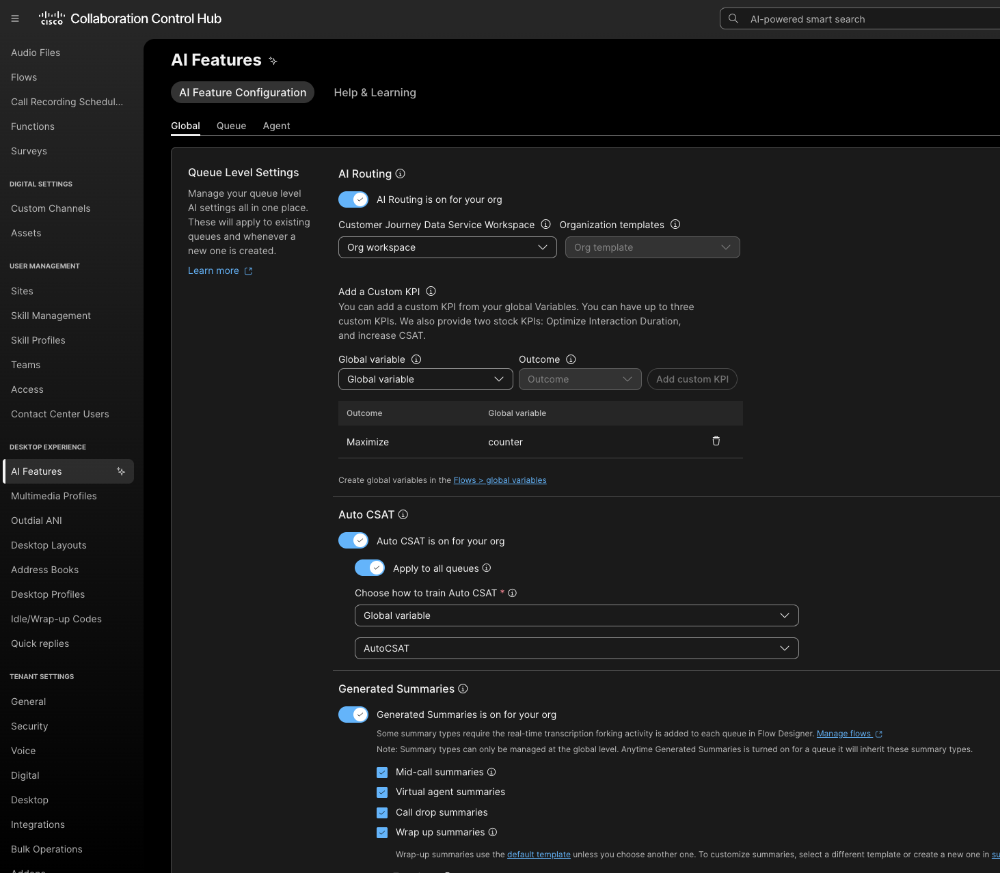
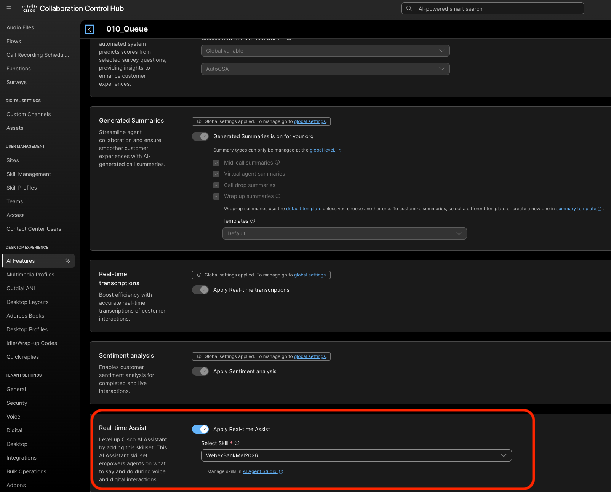
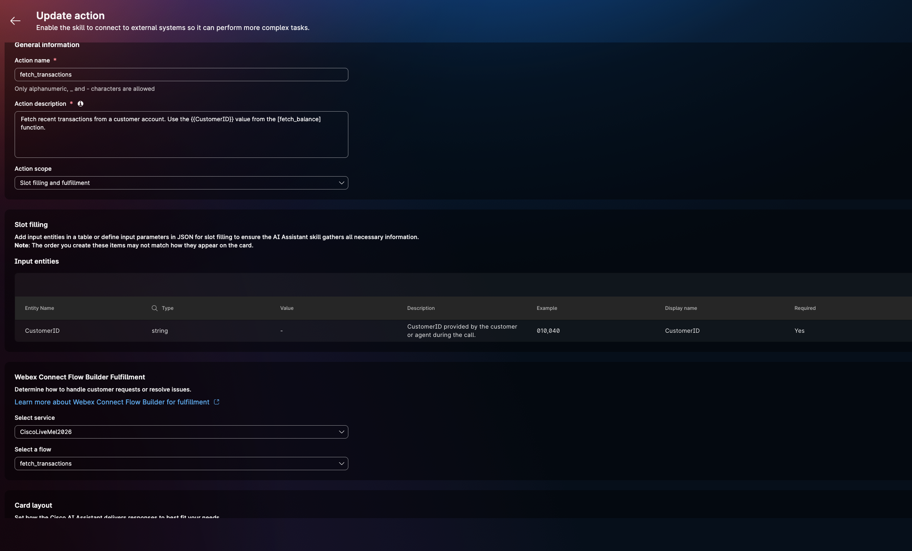
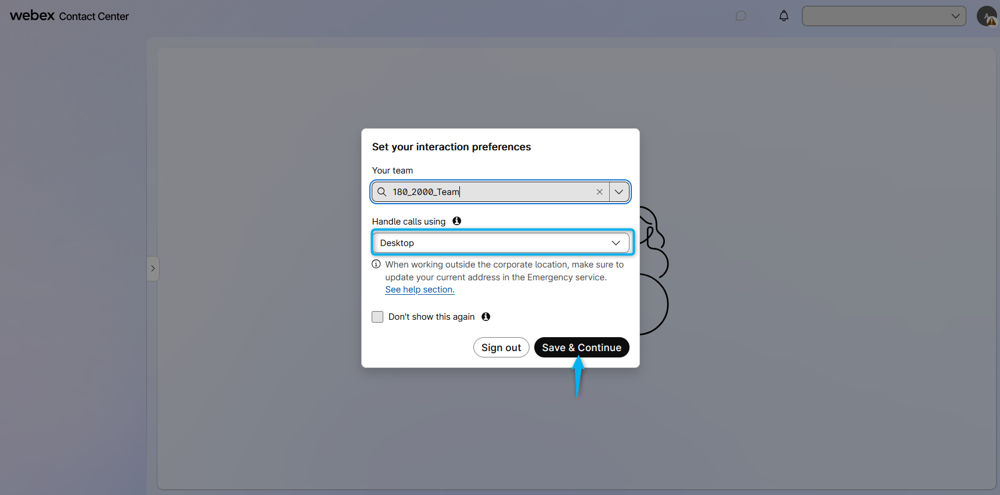
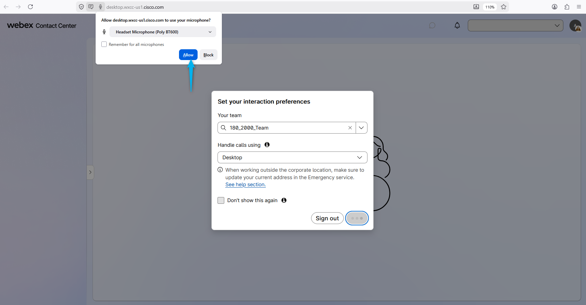
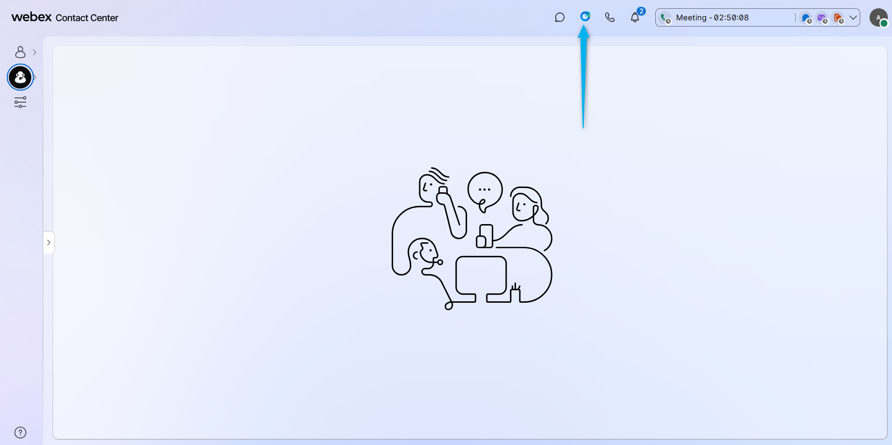
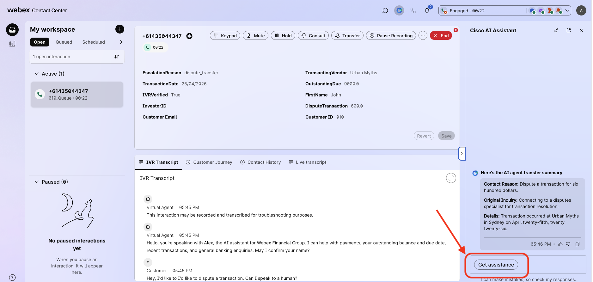

## Feature Description

AI Agent Transfer Summary enhances agent efficiency and elevate customer experiences.

When a customer calls the contact center and interacts with an AI Agent, they may request to speak with a live human agent at some point during the conversation. Once connected to an agent, it is important for the agent to receive a concise summary of the customer's interaction with the AI Agent. This summary provides the agent with a quick overview of the customer's call reason. The **AI Agent Handoff Summary** feature provides this summary, displaying it on the agent's desktop within the AI-Assistant Widget.

## Mission Details

Your mission is to:

1. Configure a smooth handoff to live human agent from AI Agent.
2. Create a summary of Virtual Agent transcript to be provided during handoff.
3. Use AI Assistant widget as an Agent.

## Build

### (<strong>Read Only</strong>) Task 1. Control Hub Settings.

1. Go to Control Hub and logon as Admin user **<copy>wxcclabs+admin_ID<w class="attendee"></w>@gmail.com</copy>**. From there, go to Contact Center > AI Features.
   

2. Go to the Queue Tab at the Top
   - Search for your queue: **<copy><w class="attendee"></w>_Queue</copy>**
   - Click on the Queue and Go to Generated Summaries and turn on Virtual agent Summaries and Wrapup Summaries.
   - In this lab it is turned on for all queues.
     

### Task 2. Turn on Real-Time Assist Feature

1. Scroll down to Real-time Assist
2. Apply Real-time Assist
3. Choose the Skill that has been created.
4. Click on the link below it that says Manage Skills in AI Agent Studio
5. Search for WebexBankMel2026
6. Let's open it and review the setup

     
7. Under Profile, we can instruct the Assistant on the kind of focused help the human would need
8. The knowledge tab has the knowledge base already selected for us.
9. The knowledge base was created using [Fraud_KB](../graphics/download/Fraud_KB.docx){: download="Fraud_KB.docx"}
10. The Actions tab helps the human agent to fetch transactions if the AI agent was asked by the customer to escalate immediately  
     

### Task 3. Test the Feature

1. Login to the **Agent Desktop** with your Agent user.
   <a href="https://desktop.wxcc-us1.cisco.com/" target="_blank">https://desktop.wxcc-us1.cisco.com/</a>

2. Select **Desktop** Handle calls using option, check that your correct team is chosen and click on **Save & Continue**.
   

3. Allow of using your headset. 
   

4. Make sure you can see the **Agent Assistant** widget.
   

5. Make sure your agent status is **Available**. 
   

6. Place a test call to the number that is associated with you Channel **<w class="attendee"></w>_Channel**, and, for example, go through the same motions as before but this time instead of outstanding dues, ask for the last transaction. Dispute this transaction. **Allow the AI Agent to complete its response before requesting to transfer the call to a live human agent**.

7. Answer the call on your Agent Desktop. You will see a window with the message **"AI agent transfer summary is ready"** pop up. You can click on **View Summary** from the window. Most of the critical details are already presented to the human agent
   

8. As a human agent, you can Get Assistance on the call on how to handle disputes.
   

9. The Assitant instructs the human agent to collect the customer ID, so the transaction can be revalidated.
    

<strong>Congratulations, you have officially completed this mission! 🎉🎉 </strong>

