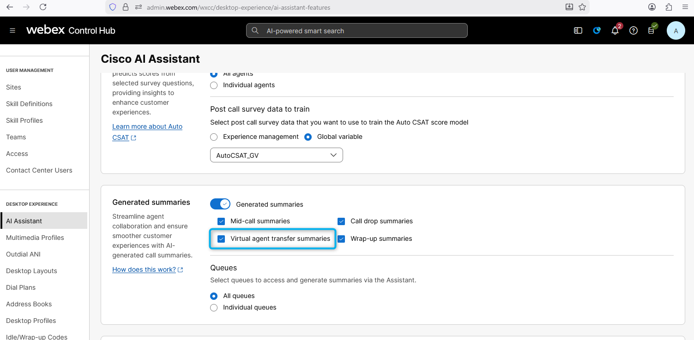
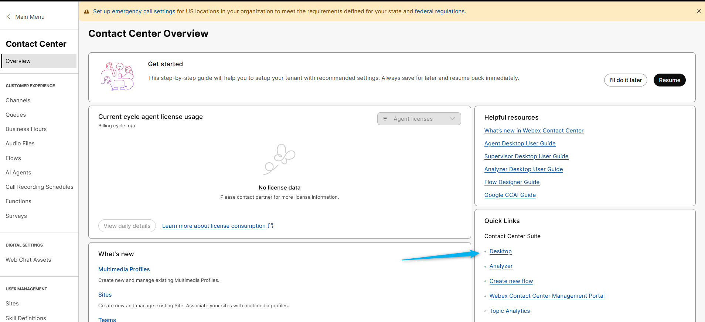
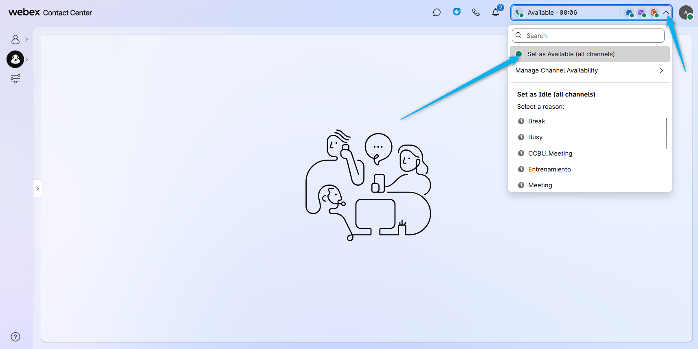
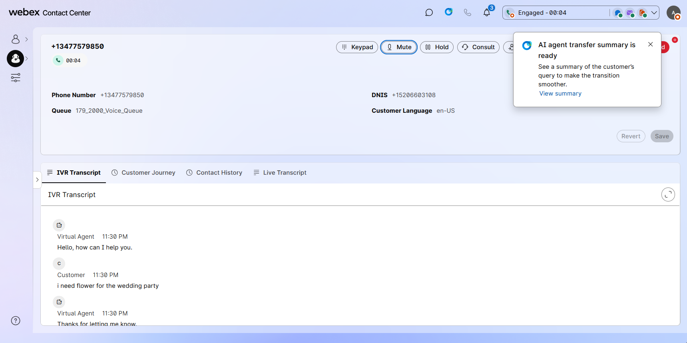
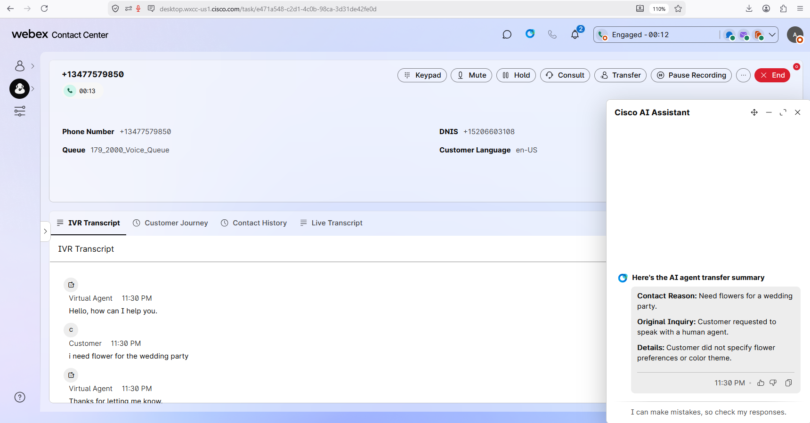

## Feature Description

AI Agent Transfer Summary enhances agent efficiency and elevate customer experiences.

When a customer calls the contact center and interacts with an AI Agent, they may request to speak with a live human agent at some point during the conversation. Once connected to an agent, it is important for the agent to receive a concise summary of the customer's interaction with the AI Agent. This summary provides the agent with a quick overview of the customer's call reason. The **AI Agent Handoff Summary** feature provides this summary, displaying it on the agent's desktop within the AI-Assistant Widget.

## Mission Details

Your mission is to:

1. Configure a smooth handoff to live human agent from AI Agent.
2. Create a summary of Virtual Agent transcript to be provided during handoff.
3. Use AI Assistant widget as an Agent.

## Build

### (<strong>Read Only</strong>) Task 1. Order Provisioning & Control Hub Settings.

1. Go to Control Hub and logon as Admin user **<copy>wxcclabs+admin_ID<w class="attendee"></w>@gmail.com</copy>**. From there, go to Contact Center > AI Features.
   

2. Go to the Queue Tab at the Top
   - Search for your queue: **<copy><w class="attendee"></w>_Queue</copy>**
   - Click on the Queue and Go to Generated Summaries and turn on Virtual agent Summaries and Wrapup Summaries.
   - In this lab it is turned on for all queues.

### Task 2. Turn on Real-Time Assist Feature

1. Scroll down to Real-time Assist
2. Apply Real-time Assist
3. Choose the Skill that has been created.
4. Click on the link below it that says Manage Skills in AI Agent Studio
5. Search for WebexBankMel2026
6. Let's open it and review the setup

### Task 3. Test the Feature

1. Login to the **Agent Desktop** with your Agenti user.
   

2. Select **Desktop** Handle calls using option and click on **Save & Continue**.
   

3. Allow of using your headset. 
   

4. Make sure you can see the **Agent Assistant** widget.
   

5. Make sure your agent status is **Available**. 
   

6. Place a test call to the number that is associated with you Channel **<w class="attendee"></w>\_2000_Channel**, and, for example, mention that you need some flowers for a wedding party. **Allow the AI Agent to complete its response before requesting to transfer the call to a live human agent**. Then ask the AI Agent to transfer you to the human agent.

7. Answer the call on your Agent Desktop. You will see a window with the message **"AI agent transfer summary is ready"** pop up. You can click on **View Summary** from the window.
   

8. The **AI agent transfer summary is ready** notification will disappear after a few seconds. However, you can always reopen it by clicking on the AI Assistant widget.
   

<strong>Congratulations, you have officially completed this mission! 🎉🎉 </strong>

