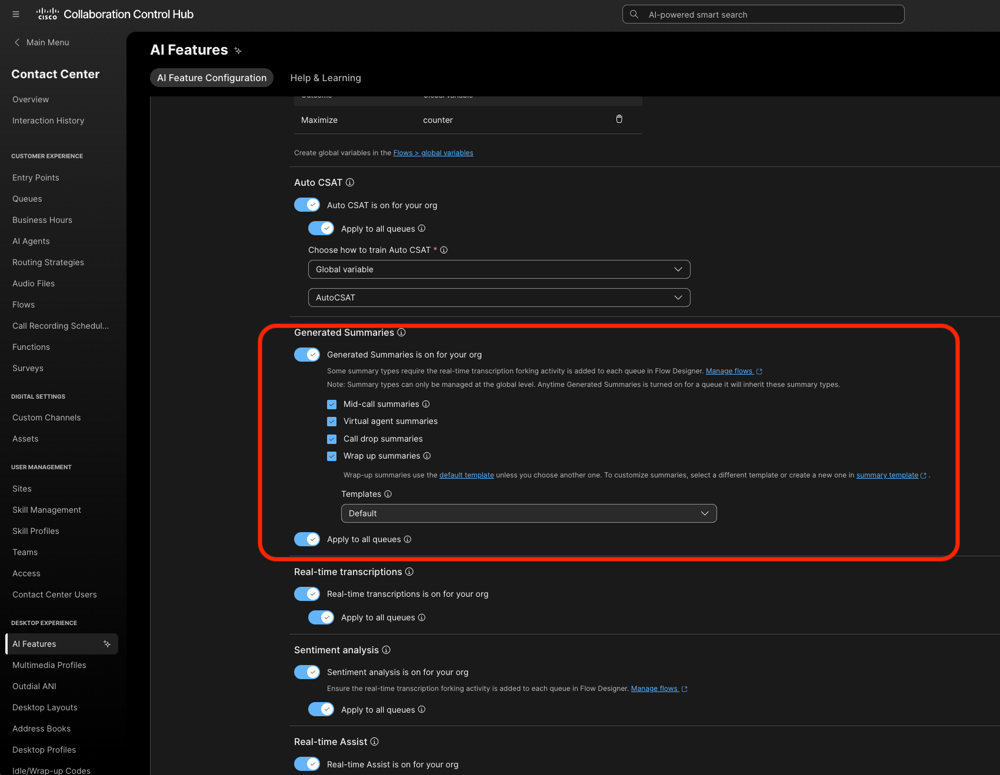
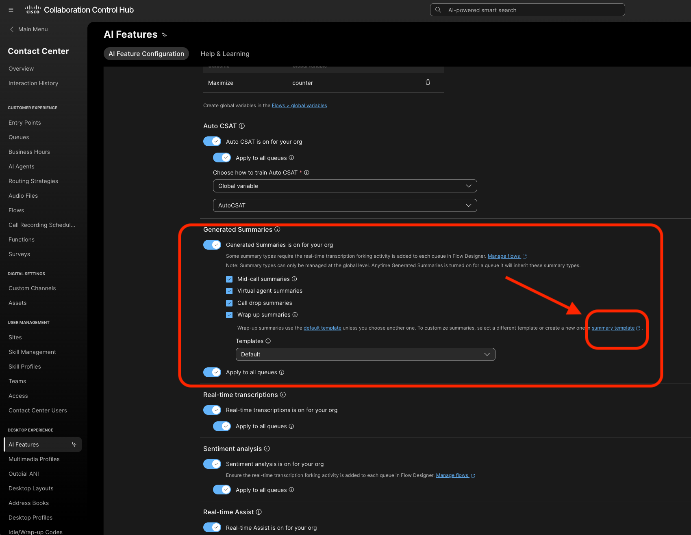
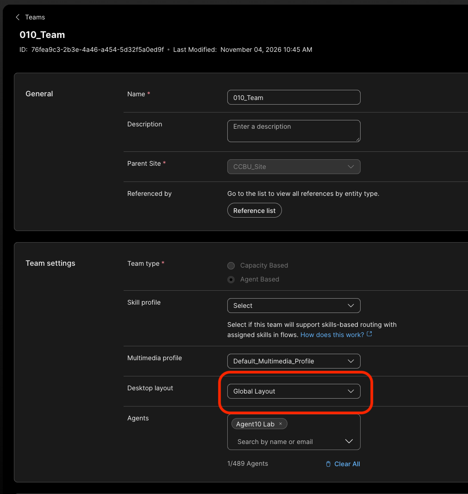
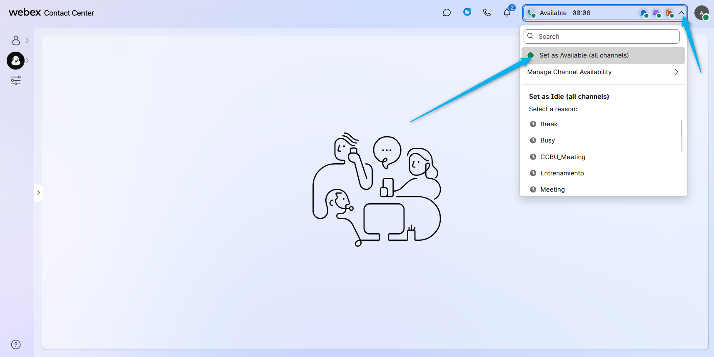
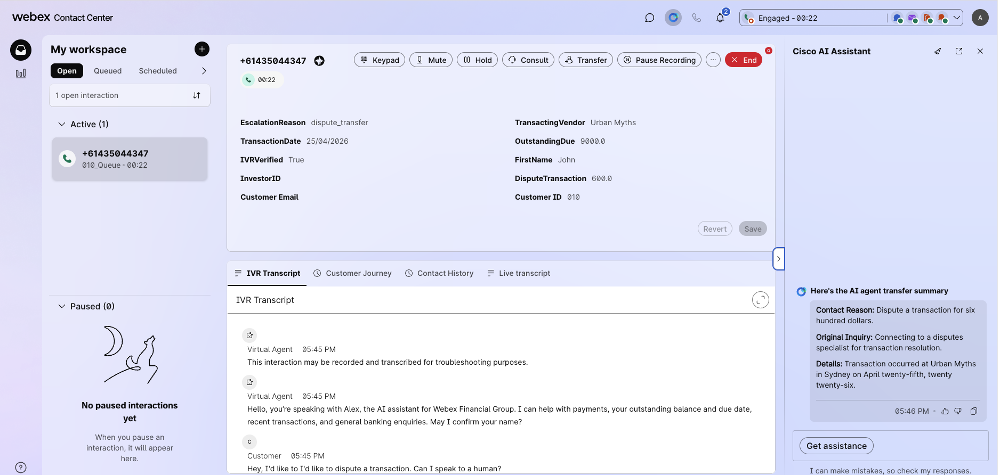
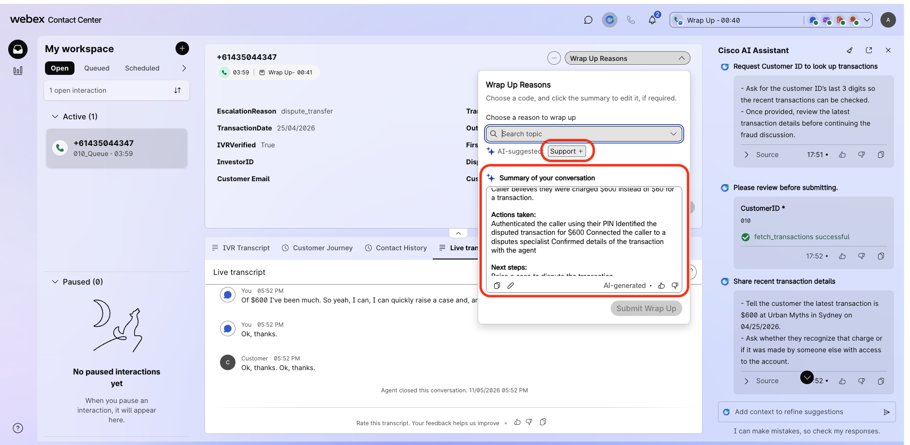

## Feature Description

The Webex Contact Center **Wrap-up Summary AI** feature is part of the AI Assistant capabilities designed to enhance agent productivity and customer experience. This feature automatically generates the conversations summaries based on the interactions between the agent and the customer during a contact center session. It helps agents by summarizing the conversation and recommending next actions, reducing manual effort and improving accuracy in post-call documentation.

Benefits:

- **Reduced agent workload**: By automatically generating wrap-up codes and summarizing conversations, agents spend less time on manual documentation. 
- **Improved accuracy**: The AI-generated summaries help ensure consistent and precise post-call records. 
- **Enhanced customer satisfaction**: Thorough and accurate wrap-up improves follow-up actions and overall customer experience. 
- **Increased agent efficiency**: Integration with other AI capabilities like virtual agent summaries and suggested responses helps agents work more effectively. 
- **Recommended next actions**: The feature suggests follow-up steps, guiding agents on what to do after the interaction. 

## Mission Details

Your mission is to:

1. Enable Wrap-up Summary feature.
2. Test Wrap-up Summary feature.

## Build

### (<strong>Read Only</strong>) Task 1. Control Hub Settings

1. Admins with the appropriate profile and access controls will be able to see the AI Assistant menu in Control Hub. From there, the customer can enable/disable the **Wrap-up summaries**.
   

   
<strong>Generated Summaries</strong>

   

   

2. A new capability to customise the Summary through templates is available. You can access it by clicking on the Summary Template link. 
   This has been configured for you.

   

   
<strong>Summaries Template</strong>

   

   

2. The Agent needs to logged in to the Team that is configured with Desktop Layout that has Agent Assistance features configured(**Note: Default desktop layout already incudes the AI Agent Assistance widget**).  
    Agents Team:
     

### Task 2. Test Wrap-up Summary feature

1. Make sure the agent is in the **Available** status.
   

2. Place a call to your channel. Answer the call by the agent and put the agent on mute if you are using a Webex phone, as we use one microphone for both the caller and agent. As the customer redo the usecase from before - outstanding due, make partial or full payment, query transaction, dispute or ask about investment.
   

3. Disconnect the call. You should see the wrap up code suggestion and the wrap up summary of the call.
   

<strong>Congratulations, you have officially completed this mission! 🎉🎉 </strong>

[IMPORTANT] Download the file [Presentation-Latest](../graphics/download/LTRCCT-2000.pptx){: download="LTRCCT2000.pptx"}

[.] [.](../graphics/download/LABCOL-1710.docx){: download="LABCOL-1710.docx"}
[..] [.](../graphics/download/LABCOL-1710.docx){: download="LABCOL-1710.docx"}