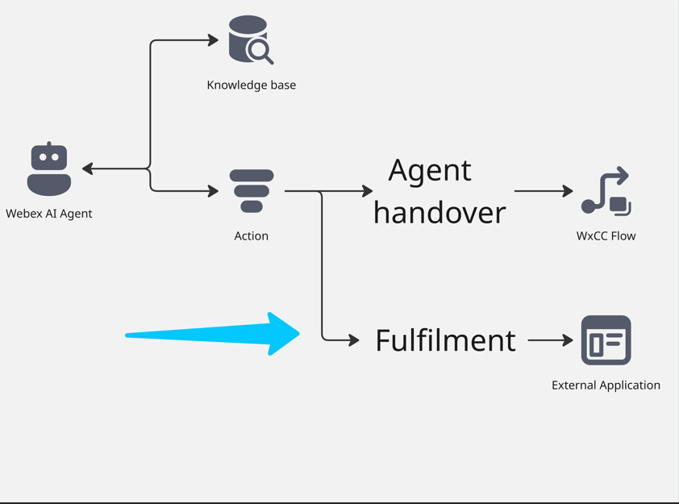
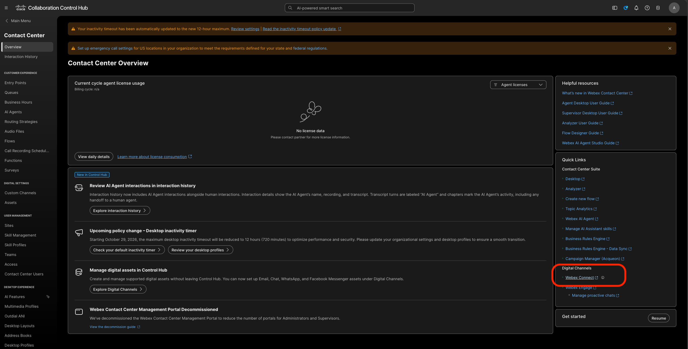
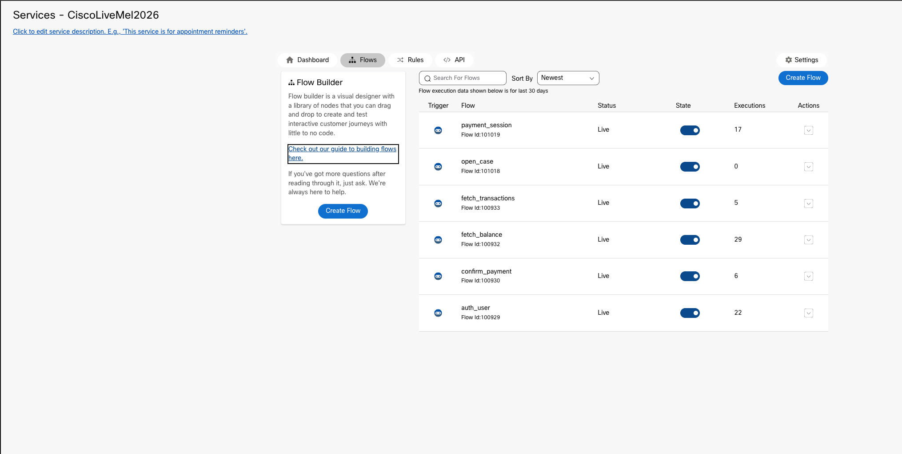
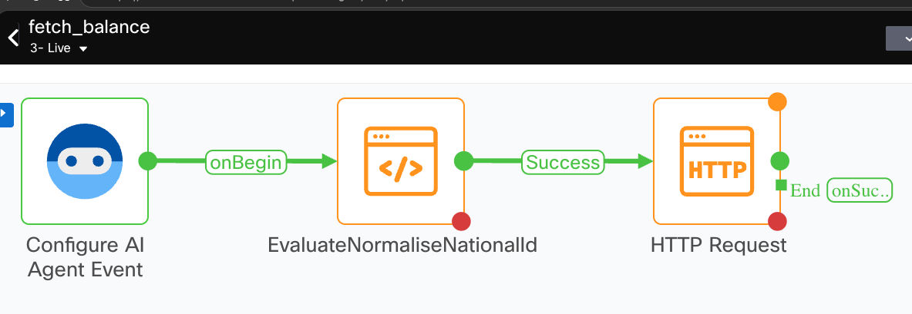

# Mission 4: Configure Fulfillment Actions and process transactions using Webex Connect Flow. 

**

What is fulfilment Action? 
**

Fulfillment Action is a task that an AI agent performs by understanding user intents and completes by connecting to external systems over API.

For more information, visit [Webex Documentation](https://help.webex.com/en-us/article/ncs9r37/Webex-AI-Agent-Studio-Administration-guide#concept-template_5ea99e1f-a679-4cf9-8e33-7a4f83d9f66a){:target="\_blank"}.

## 

## Mission overview

Your mission is to:

As the other option for Fulfillment, you can configure it in the Webex Connect flow.

Configure Fulfillment action to collect details from the customer and send them to a third-party application via APIs and return information back for delivery and or further processing.

---

## (<strong>Read Only - DO NOT EDIT - COMMON FLOWS FOR ALL</strong>)

### Create Service and AI Agent Flow in Webex Connect

1. From **Control Hub**, go to **Contact Center** > **Overview** and open up the **Webex Connect** Portal.
   

2. Open the Service with name **CiscoLiveMel2026** and go to Flows
   

3. Let's review each flow here together with the **Action in the AI Studio**

4. When configuring the AI Agent, we saw a bunch of actions. These actions were triggered based on the instructions we provided.
   - Let's look at the first set:
      - Authentication: Execute [fetch_balance] with the users's {{nationalid}} to recover the PIN . If the national id number is not available, ask the customer. Then [auth_user]

         

         
<strong>fetch_balance</strong>

         The AI Agent action hits this flow in Connect with NationalId

         

         

<!--
Internal notes:
- Confirm the lab URL.
- Update the screenshot after testing.

-->

<strong>Congratulations, you have officially completed this mission! 🎉🎉 </strong>

