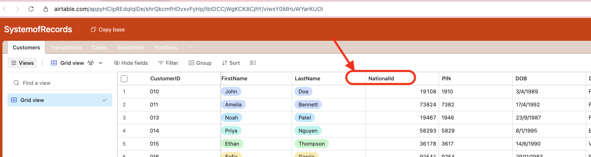
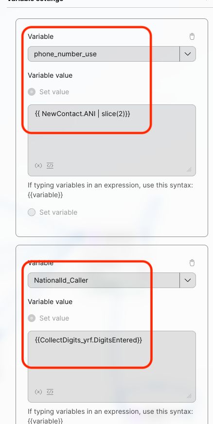
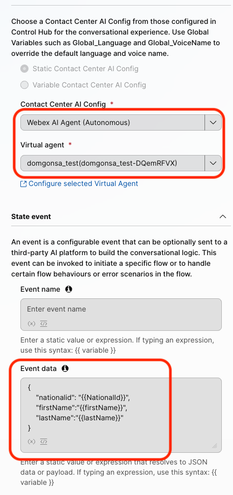
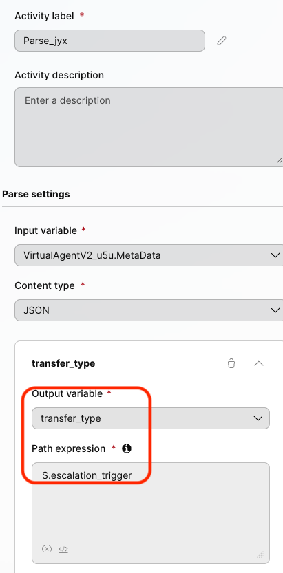
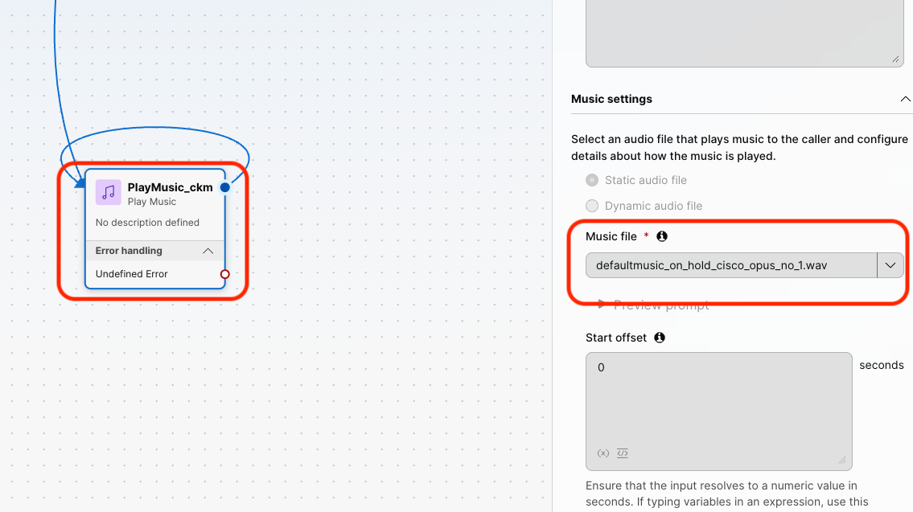
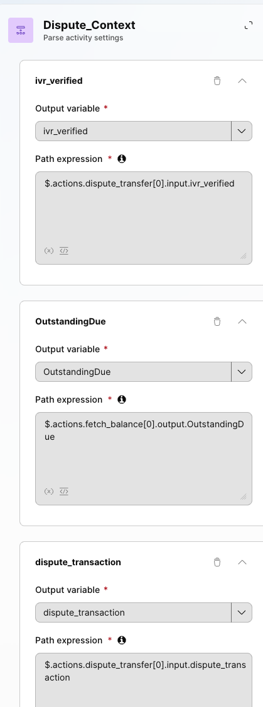

# Mission 2: Integrating the AI Agent with Flow for Voice Calls

## Mission overview

Your mission is to:

Integrate the AI Agent with the Voice Flow.

### Task 1. Download the preconfigured voice flow  
[IMPORTANT] Download the flow [Pre_config_Voice_Flow](../graphics/Lab1_AI_Agent/template_ai_agent_collection.json){: download="voice_ai_agent_fee_collection_inbound.json"} and import the WxCC voice flow and then we hook up AI Agent we built already.

1. Open [Control Hub](https://admin.webex.com){:target="_blank"} and go to **Contact Center** navigate to **Flows**, click on **Manage Flows** dropdown list and select **Create Flows**.
   

2. One the next page select **Import a flow** and click on **Next**.
   

3. Choose the file that we downloaded in step 1 above.

4. Name the new flow **<copy>AutonomousAI_Flow_2000_<w class="attendee"></w></copy>** and click on **Create Flow**.
      

5. Make sure the **Edit** mode and **Enable Decryption** is set to **ON**. You will now see that the flow is ready, well mostly.
   

6. We will now step through the different blocks and see what they mean and what they are doing.

7. Let's get into the **FLOW**:
    - The Caller hits the **CollectDigits** node
    - Collect the **NationalId** from the caller at this node - a 5 digit number that you can see in the [Airtable repo](https://airtable.com/appyHCipREdqlqiDe/shrQkcmfHDvxvFyHp){:target="_blank"}.
      
    - Next, Setting 2 variables - **phone_number_use** = {{ NewContact.ANI | slice(2)}} and **NationalId_Caller** = {{CollectDigits.DigitsEntered}} - we will be using the latter to datadip into Airtable to fetch **{{firstName}} and {{lastName}} and {{NationalId}}**
      
    - Next, on the HTTP activity, let's look at the Request URL - **https://api.airtable.com/v0/appyHCipREdqlqiDe/Customers?filterByFormula={NationalId}="{{NationalId_Caller}}"** - it uses the NationalId collected from the caller to look up the {{firstName}}, {{lastName}} and the {{NationalId}} from the single source of truth.
    - In the same activity, we need to set the Bearer token right after the word 'Bearer' and a space. Copy this from your email box that has the credentials.
    - We then play a message using Cisco TTS: **{{firstName}} {{lastName}}** - this is to tell us attendees the names for our records assigned to us so we know we are using the right records.
    - The next activity is the most important **VirtualAgentV2** node
    - This is where we bring in the **Webex AI Agent (Autonomous)**
    - We created before in Mission 1 and tested: **<w class="attendee"></w>_outstanding_collection**  
       
    - Note the Event Data inputs:
      <copy>
      {
      "nationalid": "{{NationalId}}", 
      "firstName":"{{firstName}}", 
      "lastName":"{{lastName}}"
      }
      </copy>
      These could be used inside the Agent for various reasons. Most importantly to trigger actions

8. **VirtualAgent** Handled Node can be sent to a **Play Message** activity that thanks the caller for using the AI Agent.

9. **Escalated Path - Important**
    - Connect the **Escalated** path from the **Virtual Agent V2** activity to the **Parse**
    - We now capture **$.escalation_trigger** into **transfer_type**  
          
    - Connect the **Parse** activity from previous step to the **Case** activity.
    - We route based on 3 values of transfer_type: agent_transfer, dispute_transfer, investment_transfer
      - Case 1: agent_transfer:
         - we send the caller to the after a **Play Message** = 'Your call will be sent to a human expert.' followed by a  **Queue Contact**: **<copy><w class="attendee"></w>\_Queue</copy>**
         - **Play Music**
         - Create a loop by connecting the Play Music activity back to itself - to create a music loop, following the example provided below.
         - Click on the **Play Music** node and select Music File: **defaultmusic_on_hold_cisco_opus_no_1.wav**.
            
      - Case 2: dispute_transfer:
         - Using a Parse activity, we extract the reasons for the dispute as detected by the virutal agent - from the metadata
            - where:
               - ivr_verified = $.actions.dispute_transfer[0].input.ivr_verified (It’s an entity on the dispute_transfer action, so it appears among that action’s inputs.)
               - OutstandingDue = $.actions.fetch_balance[0].output.OutstandingDue (It comes back from the Connect fetch_balance action, so it’s in that action’s output.)
               - dispute_transaction = $.actions.dispute_transfer[0].input.dispute_transaction (The agent passes the identified transaction amount into the dispute transfer action.)

            - The distinction is input versus output: action parameters are under input; values returned by Connect are under output. The names and capitalization must match the metadata exactly.

               
      - Case 3: investment_transfer:
         - Using a Parse activity, we extract the reasons for the investment based transfer as detected by the virutal agent - from the metadata
            - where:
               - investment_id  = $.actions.fetch_balance[0].output.Investments
               - customer_email = $.actions.fetch_balance[0].output.Email
               - CustomerID     = $.actions.fetch_balance[0].output.CustomerID
            - because those fields originate in fetch_balance’s output. Investments is the linked Airtable record ID you’re passing as the investment ID.

10. **Validate** and **Publish** Flow. In the popped up window, click on dropdown menu to select **Latest** label (**DO NOT** Select any other tag but only **Latest**), then click **Publish**.
      

11. Assign the Flow to your **Channel (Entry Point)**.
12. Do this by first going to **Channels** and search for your channel **<copy><w class="attendee"></w>\_2000_Channel</copy>**.
      

11. Click on **<copy><w class="attendee"></w>\_2000_Channel</copy>**. In the **Channel** settings section, change the following and then **Save** the changes. 
    Routing Flow: **<copy>AutonomousAI_Flow_2000_<w class="attendee"></w></copy>** 
    Version Label: **Latest** 
    
10. Dial the support number assigned to your **<w class="attendee"></w>\_2000_Channel** to test the Autonomous AI Agent over a voice call.
   

### Task 2. Test Agent Handoff Configurations

1. Go to **Control Hub** and from **Overview > Quick Links**, select **Desktop** option. Select **Desktop** endpoint option and choose the team **<copy><w class="attendee"></w>\_2000_Team</copy>**. Click **Save and Continue**. Allow browser to access Microphone by clicking **Allow** on every visit.
   

2. Make your Agent **Available** and you're ready to make a call.
   

3. Dial the support number assigned to your **<w class="attendee"></w>\_2000_Channel** channel, and during the conversation with the AI agent, ask to **talk to a representative or live agent**.

4. By default, the **Conversation Transcripts** setting is enabled in VirtualAgentV2 block.
   

5. With this setting enabled, the live agent can see the conversation details between the caller and the AI agent. Please check if you can view the IVR transcripts during your test calls with Agent Handoff.
   

<strong>Congratulations, you have officially completed the Autonomous AI Agent lab! 🎉🎉 </strong>

