# Mission 2: Integrating the AI Agent with Flow for Voice Calls

## Mission overview

Your mission is to:

Integrate the AI Agent with the Voice Flow.

### Task 1. Download the preconfigured voice flow  
[IMPORTANT] Download the flow [Pre_config_Voice_Flow](../graphics/Lab1_AI_Agent/template_ai_agent_collection.json){: download="voice_ai_agent_fee_collection_inbound.json"} and import the WxCC voice flow and then we hook up AI Agent we built already.

1. Open [Control Hub](https://admin.webex.com){:target="_blank"} and go to **Contact Center** navigate to **Flows**, click on **Manage Flows** dropdown list and select **Create Flows**.
   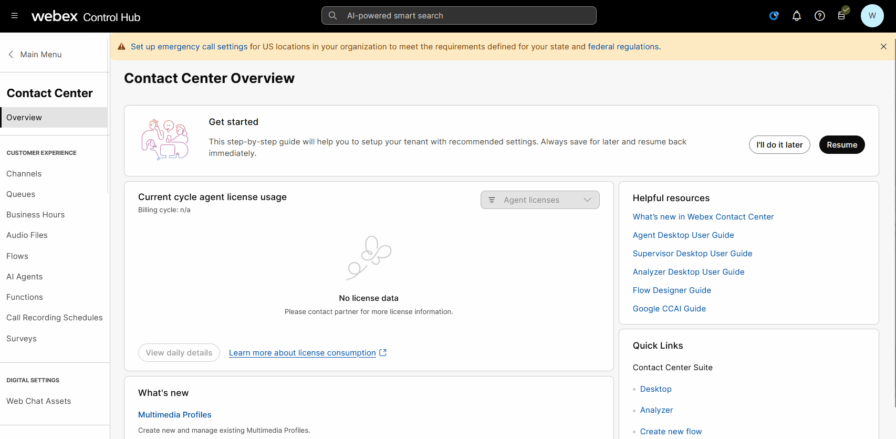

2. One the next page select **Import a flow** and click on **Next**.

   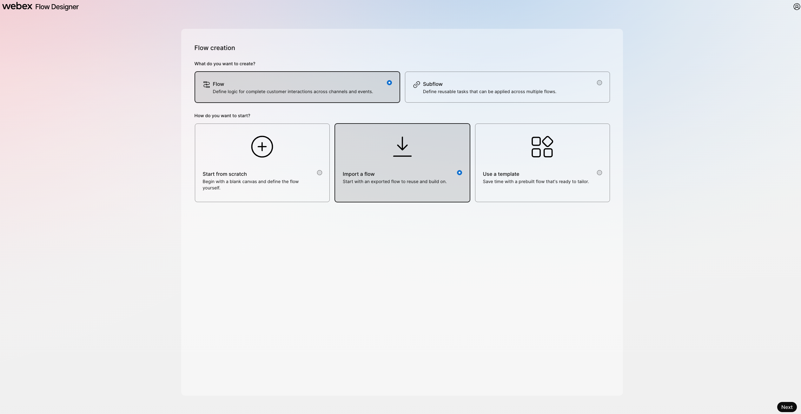

3. Choose the file that we downloaded in step 1 above.

4. Name the new flow **<copy>AutonomousAI_Flow_2000_<w class="attendee"></w></copy>** and click on **Create Flow**.

   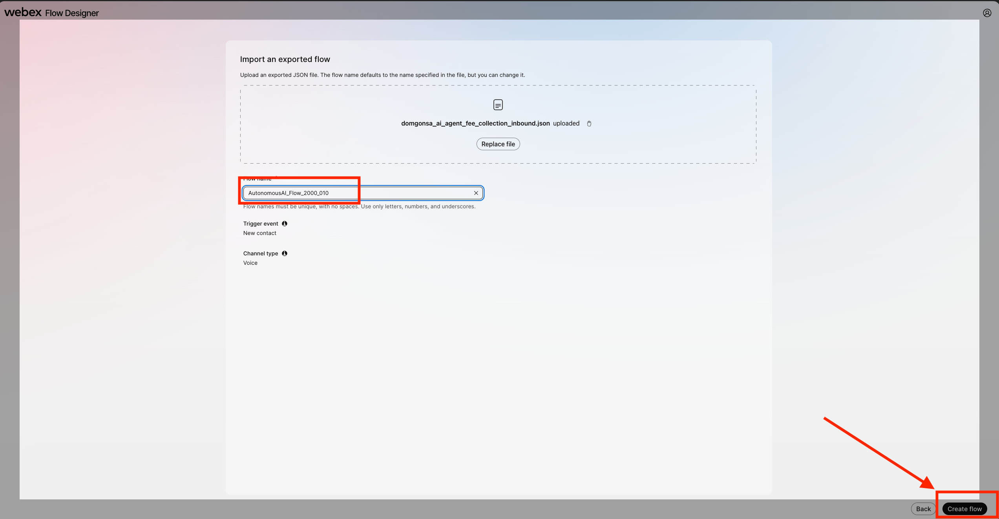

5. Make sure the **Edit** mode and **Enable Decryption** is set to **ON**. You will now see that the flow is ready, well mostly.

    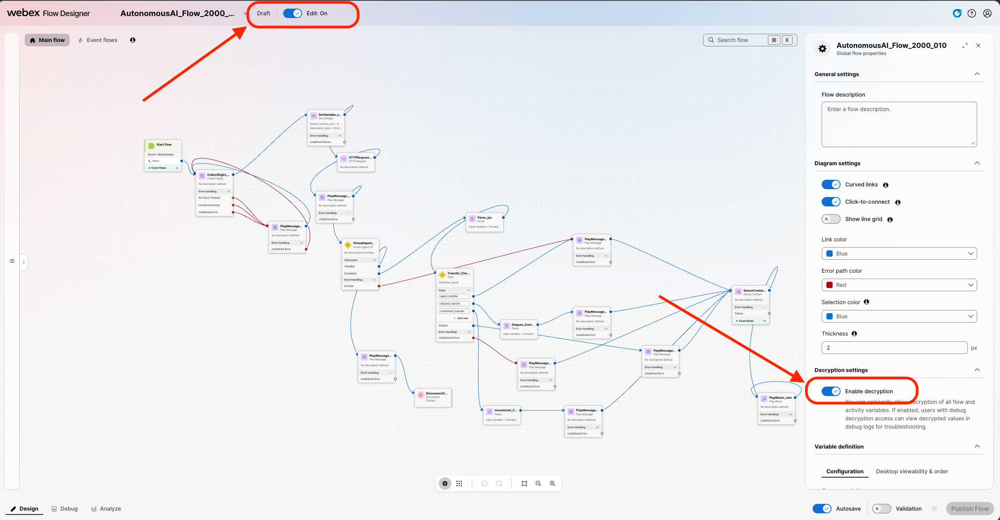
   We will now step through the different blocks and see what they mean and what they are doing.

6. Connect the nodes and configure **VirtualAgentV2**:

    - Connect the **New Phone Contact** output node edge to this **VirtualAgentV2** node.
    - Connect the **Handled** outputs to **DisconnectContact**.
    - Click on the **VirtualAgentV2** block and select **Static Contact Center AI Config**.
    - Select Contact Center AI Config as **Webex AI Agent (Autonomous)**.
    - Virtual Agent: **<copy><w class="attendee"></w>\_2000_AutoAI_Lab</copy>**

    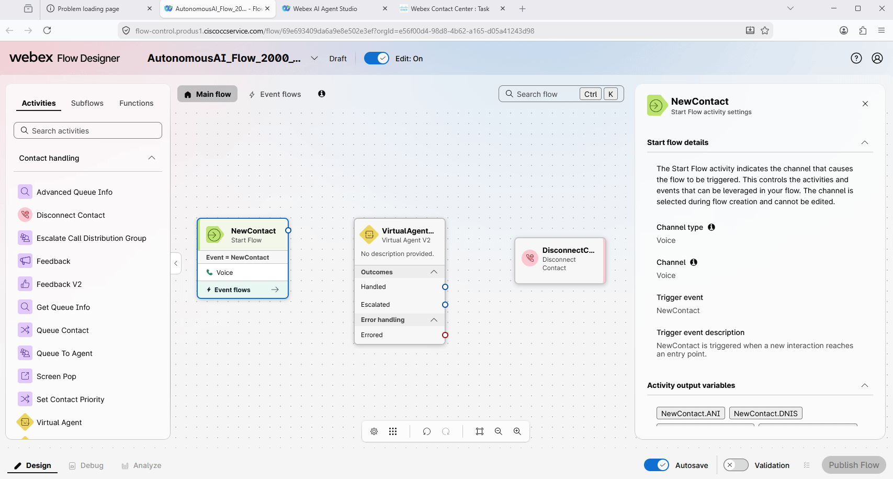

6. Drag and drop **Queue Contact** and **Play Music** nodes. Configure them as the following:

    - **Queue Contact**
    - Connect the **Escalated** path from the **Virtual Agent V2** activity to the **Queue Contact** activity.
    - Connect the **Queue Contact** activity to the **Play Music** activity.
    - Click on the **Queue Contact** node and select **Static Queue**.
    - Queue name: **<copy><w class="attendee"></w>\_2000_Voice_Queue</copy>**
    - **Play Music**
    - Create a loop by connecting the Play Music activity back to itself - to create a music loop, following the example provided below.
    - Click on the **Play Music** node and select Music File: **defaultmusic_on_hold_cisco_opus_no_1.wav**.

    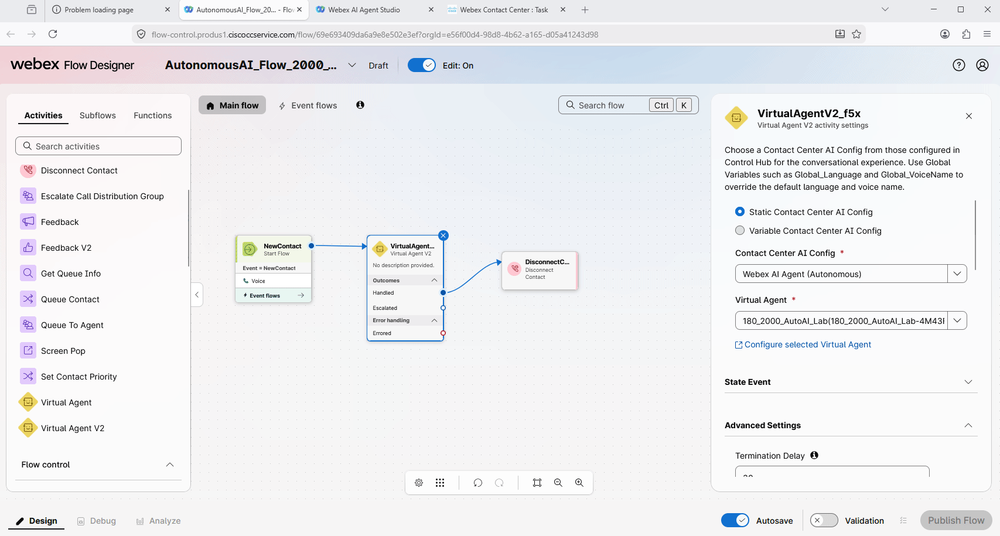

7. **Validate** and **Publish** Flow. In the popped up window, click on dropdown menu to select **Latest** label (**DO NOT** Select any other tag but only **Latest**), then click **Publish**.
   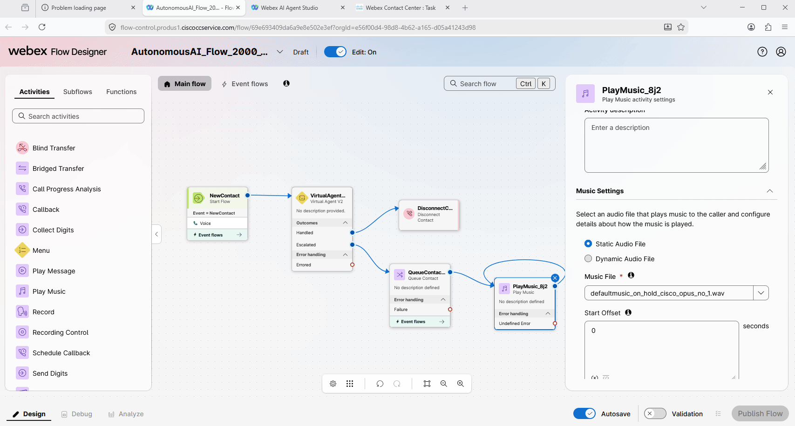

8. Assign the Flow to your **Channel (Entry Point)**. Do this by first going to **Channels** and search for your channel **<copy><w class="attendee"></w>\_2000_Channel</copy>**.
   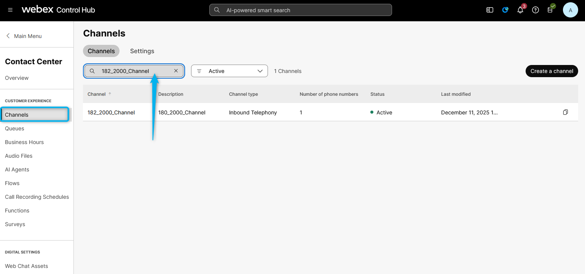

9. Click on **<copy><w class="attendee"></w>\_2000_Channel</copy>**. In the **Channel** settings section, change the following and then **Save** the changes. 
    Routing Flow: **<copy>AutonomousAI_Flow_2000_<w class="attendee"></w></copy>** 
    Version Label: **Latest** 
    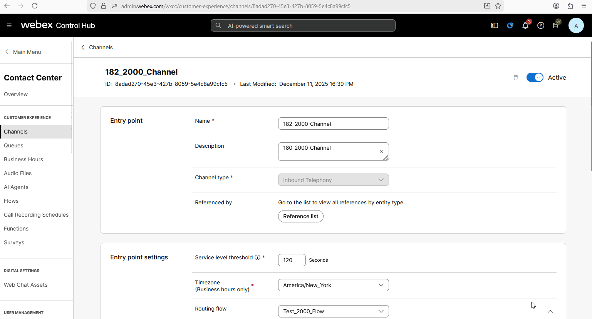
10. Dial the support number assigned to your **<w class="attendee"></w>\_2000_Channel** to test the Autonomous AI Agent over a voice call.
   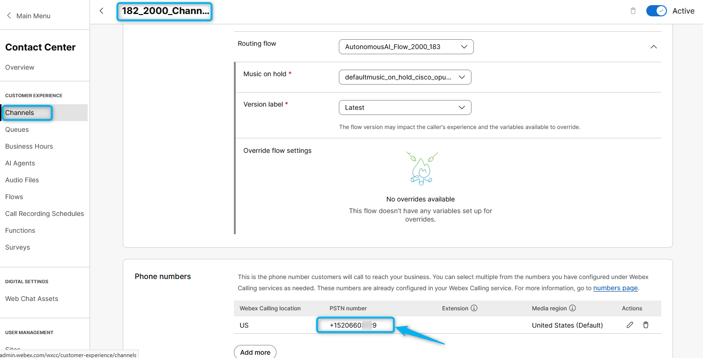

### Task 2. Test Agent Handoff Configurations

1. Go to **Control Hub** and from **Overview > Quick Links**, select **Desktop** option. Select **Desktop** endpoint option and choose the team **<copy><w class="attendee"></w>\_2000_Team</copy>**. Click **Save and Continue**. Allow browser to access Microphone by clicking **Allow** on every visit.
   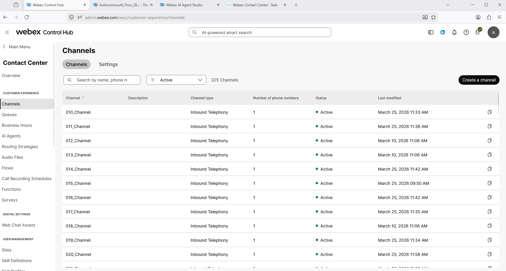

2. Make your Agent **Available** and you're ready to make a call.
   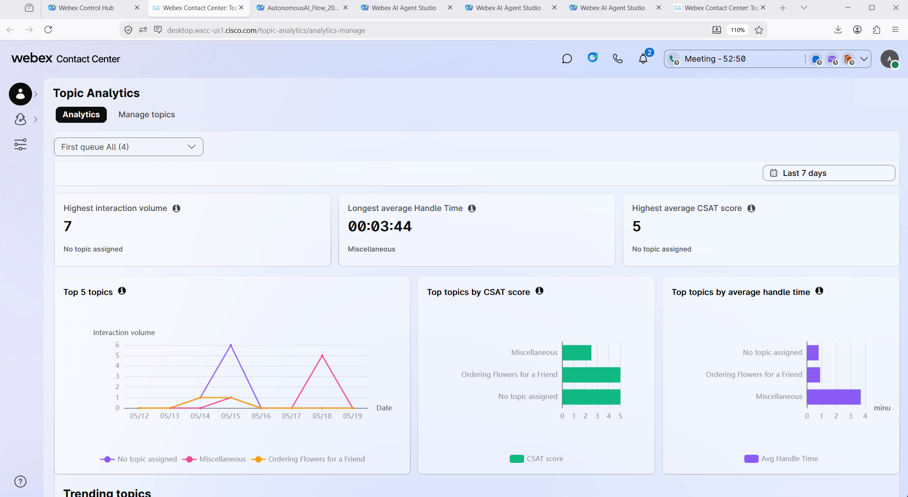

3. Dial the support number assigned to your **<w class="attendee"></w>\_2000_Channel** channel, and during the conversation with the AI agent, ask to **talk to a representative or live agent**.

4. By default, the **Conversation Transcripts** setting is enabled in VirtualAgentV2 block.
   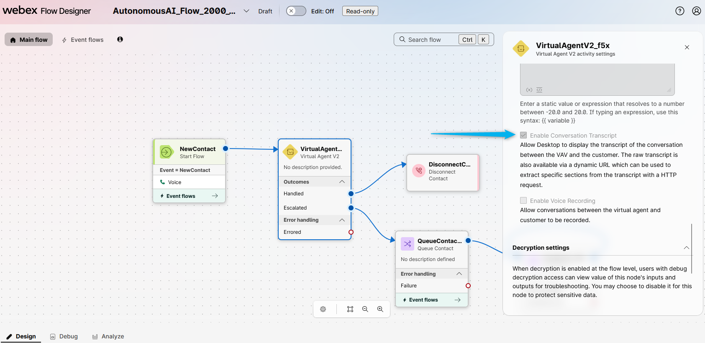

5. With this setting enabled, the live agent can see the conversation details between the caller and the AI agent. Please check if you can view the IVR transcripts during your test calls with Agent Handoff.
   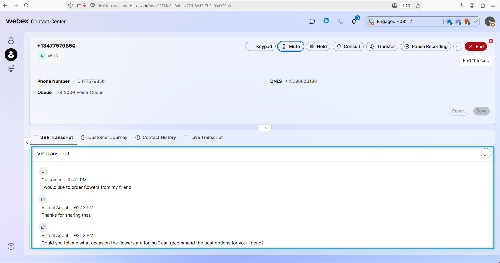

<strong>Congratulations, you have officially completed the Autonomous AI Agent lab! 🎉🎉 </strong>

