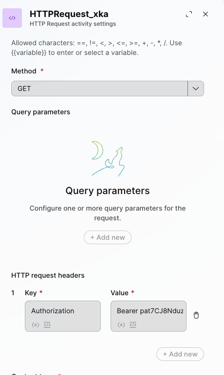
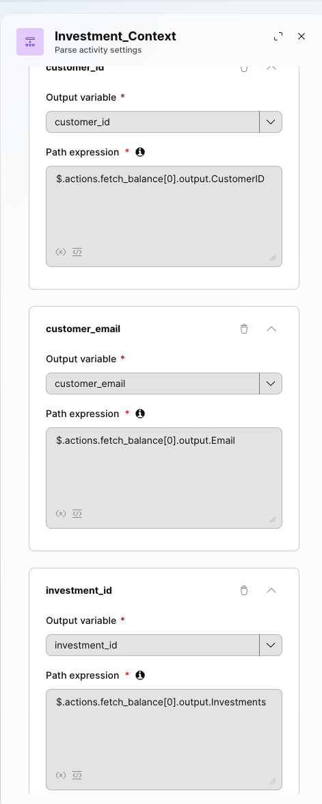
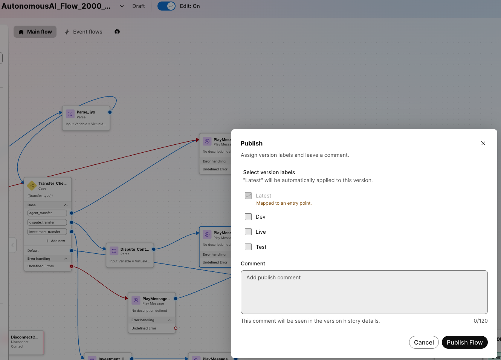
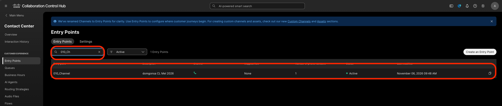
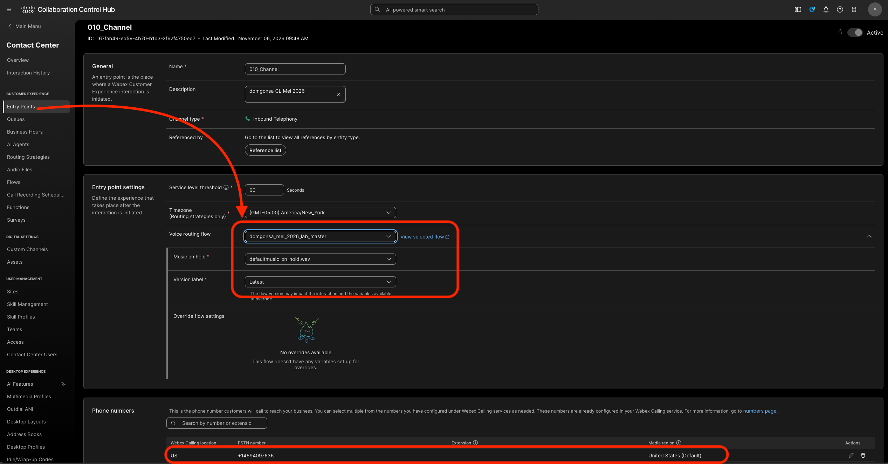

# Mission 2: Integrating the AI Agent with Flow for Voice Calls

## Mission overview

Your mission is to:

Integrate the AI Agent with the Voice Flow.

### Task 1. Download the preconfigured voice flow <br>
<span style="color: red;">[IMPORTANT]</span> Download the flow [Pre_config_Voice_Flow](../graphics/Lab1_AI_Agent/inbound_flow_ai_agent_collection.json){: download="inbound_flow_ai_agent_collection.json"} and import the WxCC voice flow and then we hook up AI Agent we built already.

1. Open [Control Hub](https://admin.webex.com){:target="_blank"} and go to **Contact Center** navigate to **Flows**, click on **Manage Flows** dropdown list and select **Create Flows**.

2. One the next page select **Import a flow** and click on **Next**.
   

3. Choose the file that we downloaded in step 1 above.

4. Name the new flow **<copy>AutonomousAI_Flow_2000_<w class="attendee"></w></copy>** and click on **Create Flow**.
   - Flow names don't like numbers to be at the start.
      

5. Make sure the **Edit** mode and **Enable Decryption** is set to **ON**. You will now see that the flow is ready, well mostly.
   

6. We will now step through the different blocks and see what they mean and what they are doing.

7. Let's get into the **FLOW**:
    - The Caller hits the **CollectDigits** node
    - Collect the **NationalId** from the caller at this node - a 5 digit number that you can see in the [Airtable repo](https://airtable.com/appyHCipREdqlqiDe/shrQkcmfHDvxvFyHp){:target="_blank"}.
      
    - Skipping the Menu and Play Message activity, we focus on the SetVariable activity, we need set two variables - **phone_number_use** = {{ NewContact.ANI | slice(2)}} and **NationalId_Caller** = {{CollectDigits.DigitsEntered}}
    - <span style="color: red;">[IMPORTANT]</span> just make sure the variables inside {{}} are correct from the activity blocks they are referenced from.
    - we will be using NationalId_Caller to datadip into Airtable to fetch **{{firstName}} and {{lastName}} and {{NationalId}}**
      
    - Next, on the HTTP activity, let's look at the Request URL - **https://api.airtable.com/v0/appyHCipREdqlqiDe/Customers?filterByFormula={NationalId}="{{NationalId_Caller}}"** - it uses the NationalId collected from the caller to look up the {{firstName}}, {{lastName}} and the {{NationalId}} from the single source of truth.
    - In the same activity, we need to set the Bearer token. Without deleting the word Bearer, replace ONLY the xxxxxx with 'your_token' from the email'. Do not include the quotes<br>

      <br>

    - Copy this from your email box that has the credentials. <br>
    
    - We then play a message using Cisco TTS: <copy>**{{firstName}} {{lastName}}**</copy> - this is to tell us attendees the names for our records assigned to us so we know we are using the right records.
    - The next activity is critical: the **VirtualAgentV2** node
    - This is where we bring in the **Webex AI Agent (Autonomous)**
    - We created before in Mission 1 and tested: **<w class="attendee"></w>_outstanding_collection** <br>
       
    - Dropdown and choose your AI agent
    - Note the Event Data inputs:
      <copy>
      ```json
      {
      "nationalid": "{{NationalId}}", 
      "firstName":"{{firstName}}", 
      "lastName":"{{lastName}}"
      }
      ```
      </copy>
      - Paste it into Event Data
      - Leave the Event Name blank
      - Event Data is how the flow can pass context into the AI agent — for example, a caller’s name or language preference or IDs — so the agent can use it in its welcome message, instructions, action descriptions, or slots.

8. **VirtualAgent** Handled Node can be sent to a **Play Message** activity that thanks the caller for using the AI Agent and disconnect the caller.

9. **Escalated Path - <span style="color: red;">[IMPORTANT]</span>>**
    - Connect the **Escalated** path from the **Virtual Agent V2** activity to the **Parse**
    - We now capture **$.escalation_trigger** into **transfer_type** flow variable already available in the flow<br>
         <br>
    - Connect the **Parse** activity from previous step to the **Case** activity.
    - We route based on 3 values of transfer_type: agent_transfer, dispute_transfer, investment_transfer
      - Case 1: agent_transfer:
         - we send the caller to the after a **Play Message** = 'Your call will be sent to a human expert.' followed by a  **Queue Contact**: **<copy><w class="attendee"></w>\_Queue</copy>**
         - **Play Music**
         - Create a loop by connecting the Play Music activity back to itself - to create a music loop, following the example provided below.
         - Click on the **Play Music** node and select Music File: **defaultmusic_on_hold_cisco_opus_no_1.wav**.
            
      - Case 2: dispute_transfer:
         - Using a Parse activity, we extract the reasons for the dispute as detected by the virutal agent - from the metadata
            - where:
               - ivr_verified = $.actions.dispute_transfer[0].input.ivr_verified (It’s an entity on the dispute_transfer action, so it appears among that action’s inputs.)
               - OutstandingDue = $.actions.fetch_balance[0].output.OutstandingDue (It comes back from the Connect fetch_balance action, so it’s in that action’s output.)
               - dispute_transaction = $.actions.dispute_transfer[0].input.dispute_transaction (The agent passes the identified transaction amount into the dispute transfer action.)

            - The distinction is input versus output: action parameters are under input; values returned by Connect are under output. The names and capitalization must match the metadata exactly.

                <br>
      - Case 3: investment_transfer:<br>
         - Using a Parse activity, we extract the reasons for the investment based transfer as detected by the virutal agent - from the metadata
            - where:
               - investment_id  = $.actions.fetch_balance[0].output.Investments
               - customer_email = $.actions.fetch_balance[0].output.Email
               - CustomerID     = $.actions.fetch_balance[0].output.CustomerID
            - because those fields originate in fetch_balance’s output. Investments is the linked Airtable record ID you’re passing as the investment ID.
             <br>

10. After the Parse activity for Cases 2 and 3, we **Play Message** just to notify the caller what is happening before dropping into the queue.

11. **Validate** and **Publish** Flow. In the popped up window, click on dropdown menu to select **Latest** label (**DO NOT** Select any other tag but only **Latest**), then click **Publish**.
      

12. Assign the Flow to your **Entry Point**.
13. Do this by first going to **Entry Points** and search for your channel **<copy><w class="attendee"></w>\_Channel</copy>**.
      

14. Click on **<copy><w class="attendee"></w>_Channel</copy>**. In the **Entry Points** settings section, change the following and then **Save** the changes.<br/>
    Routing Flow: **<copy>AutonomousAI_Flow_2000_<w class="attendee"></w></copy>**<br/>
    Version Label: **Latest**<br/>
    
15. Dial the support number assigned to your **<w class="attendee"></w>_Channel** to test the Autonomous AI Agent over a voice call.
   
   - Example Script:
      - When asked by IVR, put in your NationalId using the keypad
      - It recognises your name from Airtable record
      - Call now goes to the AI Agent
      - AI Agent tells you what it can do
      - Offers you to be authenticated
      - You agree
      - AI Agent asks you for specific position digits
      - You read out the specific digits of the pin, like 'zero' 'one' or 'one' 'one' etc.
      - Authenticates and offers you your outstanding due
      - Offers you full or partial payment
      - You pick what you like
      - It send you an email with the payment link from Novapay on the email address you have acces to for this lab
      - You ask the agent to wait while you put in the payment
      - You can use dummy card 4242 4242 4242 4242
      - Exp 01/29
      - CVV 123
      - Pay
      - Let the agent know you have paid and ask the agent to confirm that you have paid
      - Agent will trigger a backend check to see if you have and update the Airtable record
      - You can refresh the [Airtable](https://airtable.com/appyHCipREdqlqiDe/shrQkcmfHDvxvFyHp){:target="_blank"} and see if the OutstandingDue has been updated with the correct balance
      - You could then ask about investments or ask for last transaction and then want to dispute it
      - Agent will transfer you to a human

### Task 2. Test Agent Handoff Configurations

1. Go to <a href="microsoft-edge:https://desktop.wxcc-us1.cisco.com">https://desktop.wxcc-us1.cisco.com</a>. Select **Desktop** endpoint option and choose the team **<copy><w class="attendee"></w>\_Team</copy>**. Click **Save and Continue**. Allow browser to access Microphone by clicking **Allow** on every visit.
   

2. Make your Agent **Available** and you're ready to make a call.
   

3. Dial the support number assigned to your **<w class="attendee"></w>\_Channel** channel, and during the conversation with the AI agent, ask to **talk to a representative or live agent**.

4. By default, the **Conversation Transcripts** setting is enabled in VirtualAgentV2 block.
   

5. With this setting enabled, the live agent can see the conversation details between the caller and the AI agent. Please check if you can view the IVR transcripts during your test calls with Agent Handoff.
   

<p style="text-align:center"><strong>Congratulations, you have officially completed the Autonomous AI Agent lab! 🎉🎉 </strong></p>
