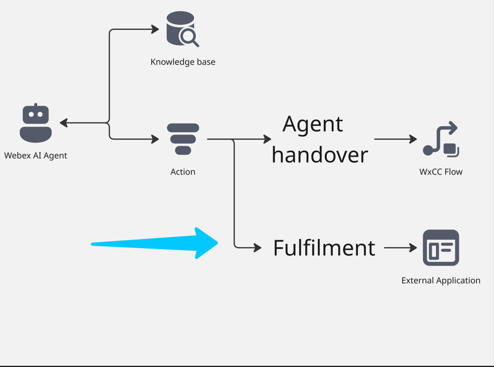
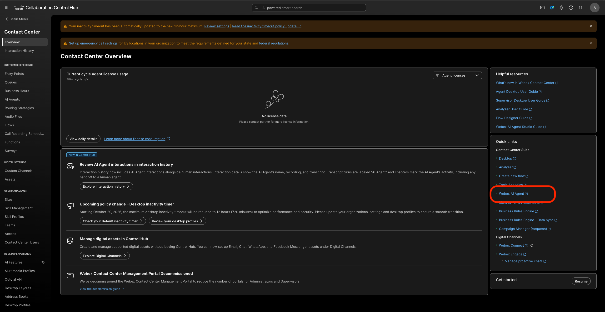
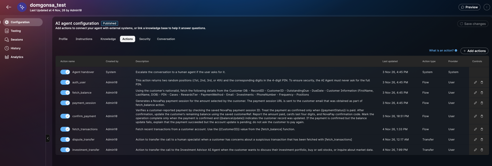
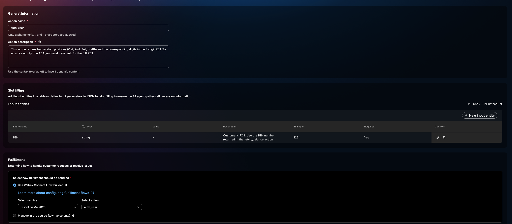
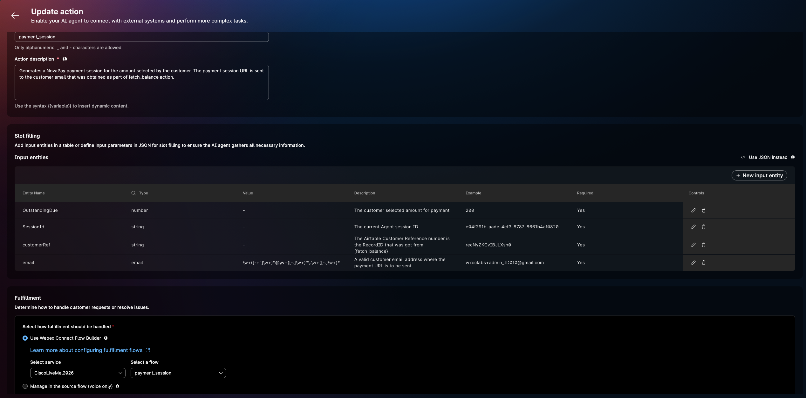
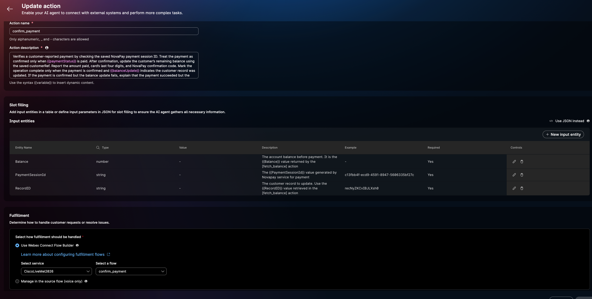
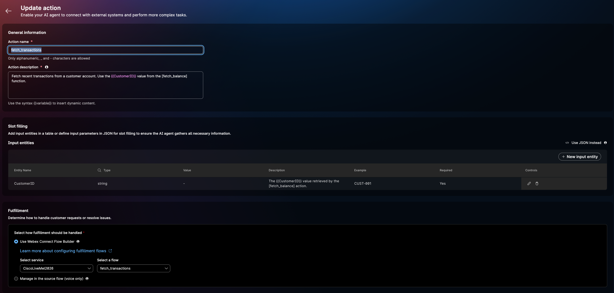
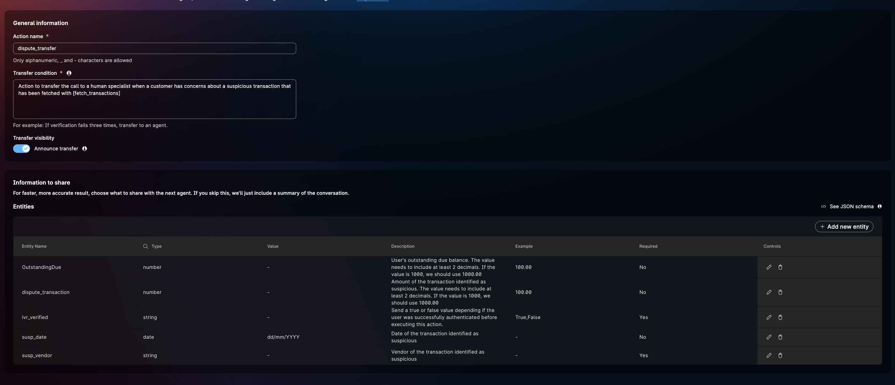
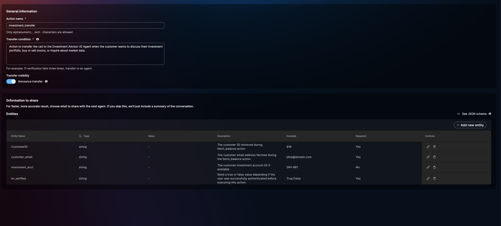

# Mission 3: Configure Fulfillment Action and create an order using **Voice Flow**. 

**

What is fulfilment Action? 
**

Fulfillment Action is a task that an AI agent performs by understanding user intents and completes by connecting to external systems over API. 

## 

## Mission overview

In this Mission you will be using the Voice flow to execute the API call to create teh order in order to complete the AI Agent Fulfillment. 

---

## Build

### Task 1. (<strong>Read Only</strong>) Configure Action in the AI Studio 

1. Go to **Webex AI Agent AI** Studio Portal. Control Hub > Services > Contact Center > Overview > Webex AI Agent (under Quick Links)
   

2. Select your AI agent with name **<copy><w class="attendee"></w>\__outstanding_collection</copy>** that you created earlier and go to **Actions**. You will see ALL Actions are already created for you. We will now review each action. If you have to create an action, you would click on Add Actions are the right hand top corner.
   
      - Action 1: fetch_balance with the known NationalId and setup the next auth step; use the fethc_balance Connect flow to fetch:
         - RecordID
         - CustomerID
         - OutstandingDue
         - DueDate
         - Customer Information (FirstName, LastName, DOB)
         - PIN
         - Cases
         - RewardsTier
         - PaymentMethod
         - Email
         - Investments
         - PhoneNumber
         - Frequency
         - Positions
      - Action 2: auth_user: the AI Agent will want to authenticate by triggering this action that is hooked up to the Connect flow auth_user to randomise the PIN
         
      - Action 3: payment_session: this action connects to the NovaPay payment gateway for creating the session and email your email address for this lab.
         
      - Action 4: confirm_payment: while on call with the AI agent, the caller can pay the OutstandingDue $ and ask for confirmation. You can do this yourself.
         
      - Action 5: fetch_transactions: on the same call the caller may want to query a transaction and ask for the last transaction. This action will achieve that.
         
      - Action 6: dispute_transfer: transfer to a human specialist when a customer has concerns about a suspicious transaction that has been fetched with [fetch_transactions]
         
      - Action 7: investment_transfer: when investment discussions start the call is handed off to a human expert
         

3. If you make any updates to this agent, remember to Save Changes and Publish

<strong>Congratulations, you have officially completed the Autonomous AI Agent Fulfillment lab! 🎉🎉 </strong>

