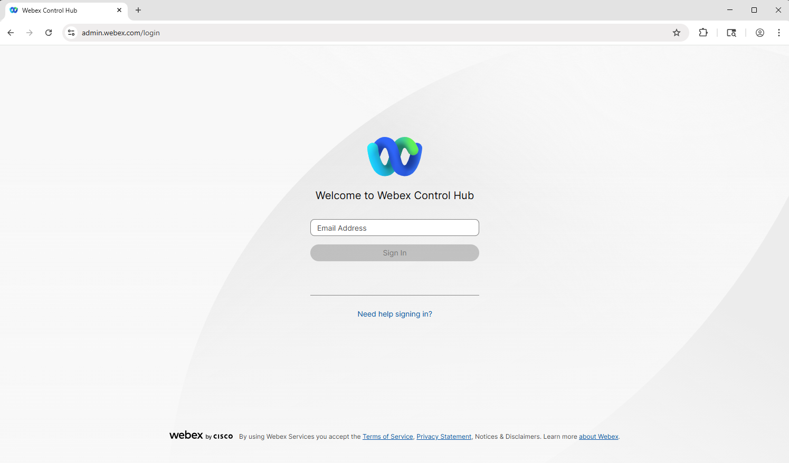
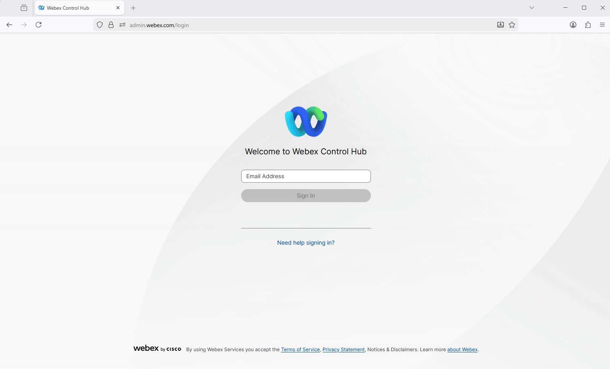
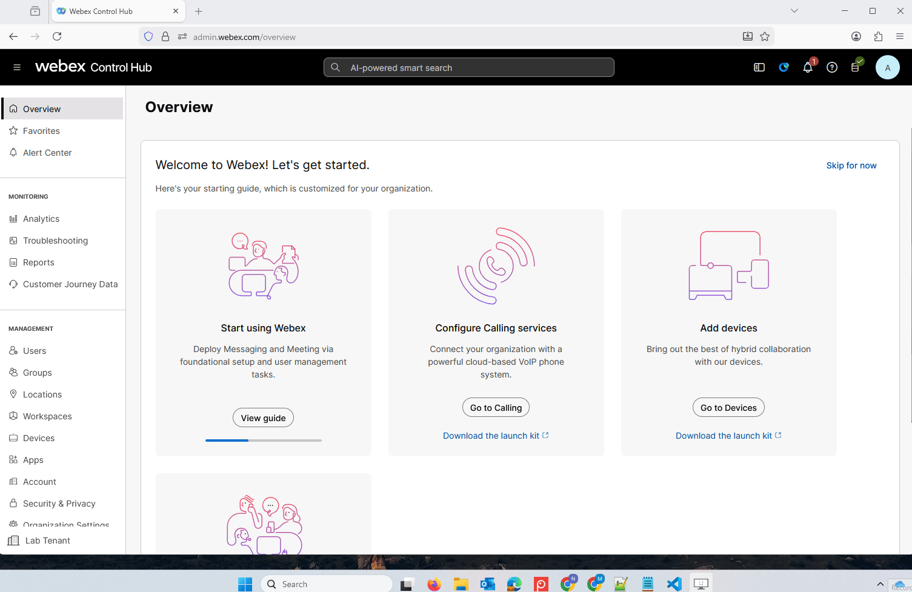
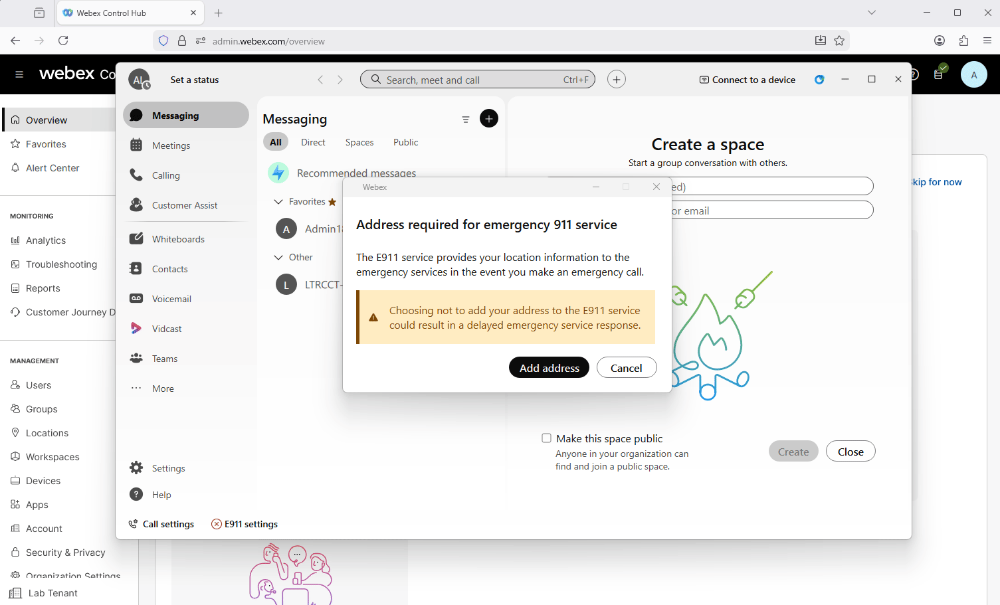
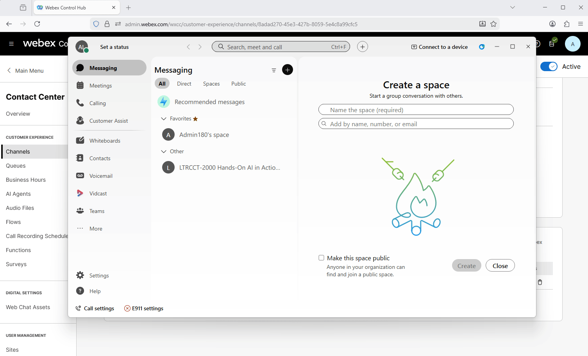

## Quick Links

<table>
   <tr>
    <td style="background-color: #d9edf7; font-weight: bold; color: black;">Email Box</td>    
    <td><a href="https://webmail.appinzip.com/" target="_blank">https://webmail.appinzip.com/</a></td>
  </tr>
    <tr>
    <td style="background-color: #d9edf7; font-weight: bold; color: black;">Email Address</td>    
    <td><copy>wxcclabsadmin_ID<w class="attendee"></w>@appinzip.com</copy></td>
  </tr>
  <tr>
    <td style="background-color: #d9edf7; font-weight: bold; color: black;">Control Hub</td>    
    <td><a href="https://admin.webex.com/" target="_blank">https://admin.webex.com/</a></td>
  </tr>
  <tr>
    <td style="background-color: #d9edf7; font-weight: bold; color: black;">Agent Desktop - using Edge</td>
    <td><a href="microsoft-edge:https://desktop.wxcc-us1.cisco.com">https://desktop.wxcc-us1.cisco.com</a></td>
  </tr>
   <tr>
    <td style="background-color: #d9edf7; font-weight: bold; color: black;">Lab WxSpace</td>
    <td><a href="webexteams://im?space=855058e0-db09-11f1-9147-bbd8a6018c8e" target="_blank">LTRCCT-2000</a></td>
  </tr>
</table>

## Learning Objectives

### Know before you start

1. We will be using a shared lab tenant for simulations, meaning all attendees will work within the same Webex Contact Center environment. To avoid conflicts, ensure that any entities you configure are tagged with the Attendee ID assigned to you.
2. The majority of the configuration in Control Hub is already set up, allowing you to focus primarily on configuration of **Webex AI Agent** and other AI features.
3. Of course, there may still be some elements to adjust, but these should be minimal, letting you concentrate on building and refining the flow logic rather than spending time on flow setup.
4. The Human Agent has been configured for you. You will be performing the rest of the configuration for the AI Agent and the integration with the channels. The Agent Desktop focus is towards the end because we are focusing on AI Agent capabilities - automating balance due, PIN based auth, offering partial and full payment options, making the payment while on call, validating that payment has been received, escalating a disputed transaction, checking the agent desktop when it comes through to a human etc.
5. Please ask for help when you need it.

---

### Predefined configuration - Found in your dedicated mailbox

> > [Check your email](https://webmail.appinzip.com){:target="\_blank"}
Put in your email address: **<copy>wxcclabsadmin_ID<w class="attendee"></w>@appinzip.com</copy>**
Use the Password that has been provided to you.

> Entry Point/Channel: **<copy><w class="attendee"></w>\_Channel</copy>**

> Queue: **<copy><w class="attendee"></w>\_Queue</copy>**

> Team: **<copy><w class="attendee"></w>\_Team</copy>**

> Admin: **<copy>wxcclabs+admin_ID<w class="attendee"></w>@gmail.com</copy>**

> Supervisor: **<copy>wxcclabs+supvr_ID<w class="attendee"></w>@gmail.com</copy>**

> Webex App has been pre-installed on your Lab PC
   >> Login with your Admin: **<copy>wxcclabs+admin_ID<w class="attendee"></w>@gmail.com</copy>** username and password

> Inbound Phone Number: Assigned to your Channel **<copy><w class="attendee"></w>\_Channel</copy>**  

> [Airtable](https://airtable.com/appyHCipREdqlqiDe/shrQkcmfHDvxvFyHp){:target="\_blank"} Webmode Read-ONLY. [IMPORTANT:]  Airtable CustomerID = Your Attendee ID = **<copy><w class="attendee"></w></copy>**  
Use ONLY your row for data. We will come to this later  

> You can access the shared Read-ONLY Airtable Repo using your email address specially made for this lab:
Admin: **<copy>wxcclabsadmin_ID<w class="attendee"></w>@appinzip.com</copy>**  

> [Check your email](https://webmail.appinzip.com){:target="\_blank"}
Put in your email address from above. For example: wxcclabsadmin_ID010@appinzip.com
Use the Password that has been provided to you.

> You can find an email from domgonsa@cisco.com that has all the other details like: Entry Point, EP-DN etc.

More pre-configured entities will be in your mailbox or mentioned during the lab missions if they have any.

---

### Login Access

#### Login to Control Hub.

1. Open up Google Chrome Web browser and login to [Control Hub](https://admin.webex.com){:target="\_blank"}.
   

2. Login using your provided Admin username and password. You can find this in your email inbox above.
   

#### Login to Webex App - this is for making calls into Webex Contact Center ONLY.

1. Open the **Webex App** on your PC.
   

2. **Sign in** using the Admin credentials - Admin: **<copy>wxcclabs+admin_ID<w class="attendee"></w>@gmail.com</copy>**. (The same credentials you used to login to the Control Hub).
   

3. If you receive a prompt to add an Address, click **Cancel**.
   

#### Calling to Contact Center
Place test call to the test number +14694097636 to confirm that you Webex Phone is configured to place calls. You will hear a response from the test flow. If you are planning to use your cellphone for testing you can also try to call the number.
   
